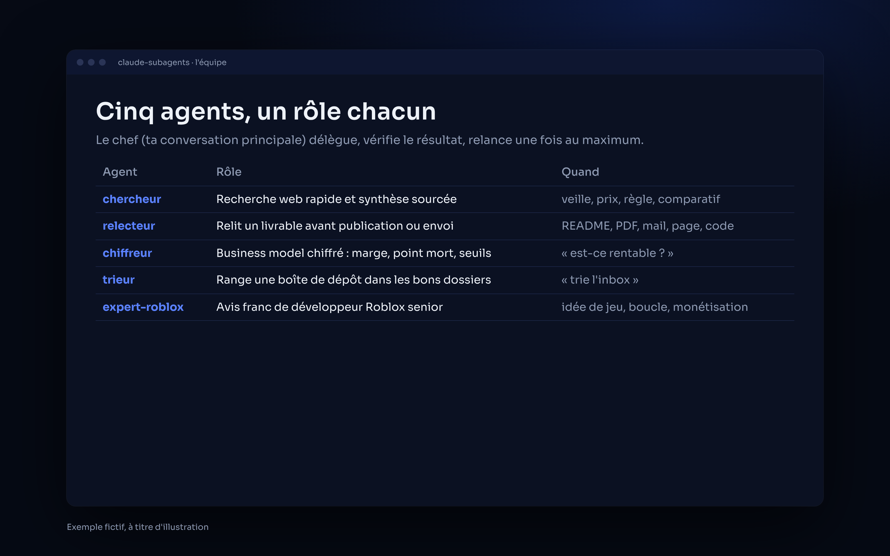
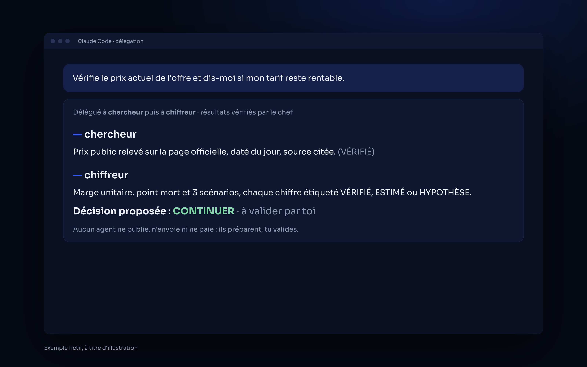

<p align="center">
  
</p>

<p align="center">
  
  
  
</p>

# Claude Subagents — une petite équipe d'agents pour Claude Code

**Cinq sous-agents prêts à l'emploi, un rôle chacun : chercher, relire, chiffrer, ranger, et un avis d'expert Roblox. Ta conversation principale délègue, vérifie et décide.**
*Five ready-to-use Claude Code subagents: research, review, business numbers, inbox triage and a Roblox expert.*

## ✦ Les agents

| Agent | Modèle | Rôle |
|---|---|---|
| [**chercheur**](agents/chercheur.md) | Haiku | Recherche web rapide et synthèse sourcée, chaque chiffre étiqueté VÉRIFIÉ, ESTIMÉ, HYPOTHÈSE ou INCONNU. |
| [**relecteur**](agents/relecteur.md) | Sonnet | Relit un livrable avant publication ou envoi : données personnelles et secrets d'abord, puis faits, cohérence, fautes. |
| [**chiffreur**](agents/chiffreur.md) | Sonnet | Business model chiffré : marge unitaire, point mort, 3 scénarios, seuils STOP / PIVOT / CONTINUER. |
| [**trieur**](agents/trieur.md) | Haiku | Range un dossier de dépôt en vrac dans les bons projets, sans jamais supprimer. |
| [**expert-roblox**](agents/expert-roblox.md) | Opus | Avis franc de développeur Roblox senior : plaisir, 30 premières secondes, serveur autoritaire, performance mobile, monétisation honnête. |

**Règles communes** : aucun agent ne publie, n'envoie, ne paie ni ne supprime. Chacun termine par une section « À noter » que la conversation principale reporte dans la mémoire du projet.

## ✦ Aperçu

L'équipe, puis une délégation en deux temps :

<p align="center">
  
  
</p>

<p align="center"><sub><i>Exemple fictif, à titre d'illustration.</i></sub></p>

## ✦ Installation

```bash
git clone https://github.com/horizonchapter/claude-subagents.git
cp claude-subagents/agents/*.md ~/.claude/agents/
```

Pour un seul projet : copie les fichiers dans `.claude/agents/` du projet. Garde seulement les agents dont tu as besoin.

## ✦ Utilisation

Claude Code choisit l'agent d'après sa description, ou tu le demandes :

- « Demande au chercheur le prix actuel de cet outil. »
- « Fais relire ce README par le relecteur avant que je publie. »

## ✦ Structure

```
claude-subagents/
├── agents/        les 5 agents (un fichier Markdown chacun)
├── assets/        bannière et aperçus
├── CHANGELOG.md · CONTRIBUTING.md · SECURITY.md · LICENSE
└── .github/ISSUE_TEMPLATE/
```

## ✦ Voir aussi

- [chef-employe](https://github.com/horizonchapter/chef-employe) : la méthode pour déléguer à des modèles moins chers et mesurer l'économie.
- [chiffrage-projet](https://github.com/horizonchapter/chiffrage-projet) · [roblox-skills](https://github.com/horizonchapter/roblox-skills) · [horizon-aios](https://github.com/horizonchapter/horizon-aios)

## ✦ Licence

[MIT](LICENSE). Libre d'utilisation, de modification et de partage.
